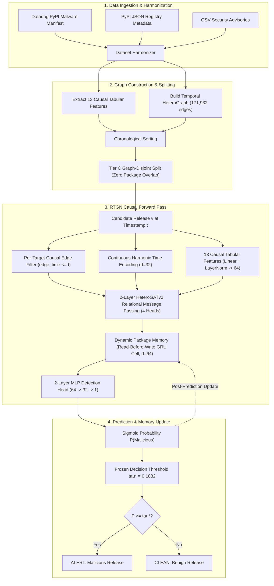
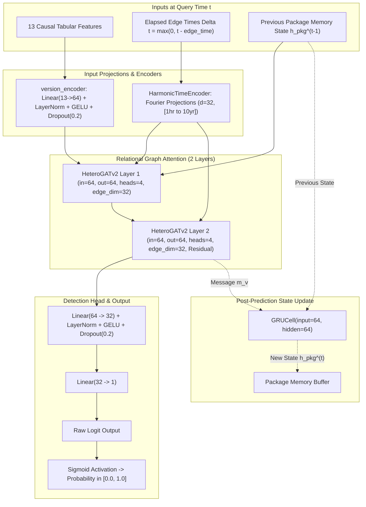
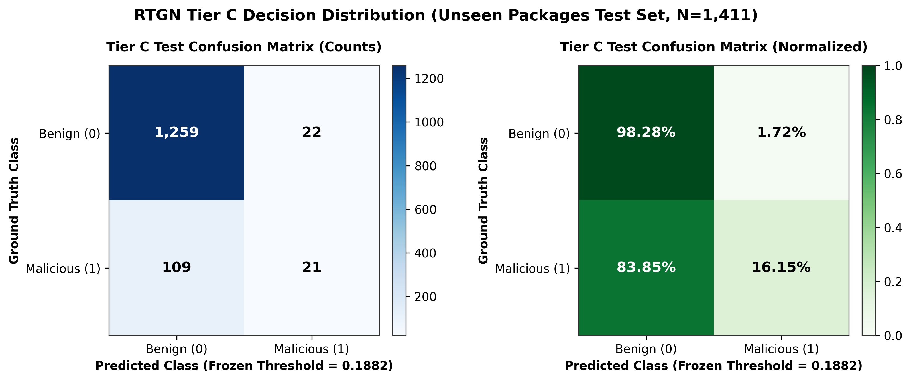
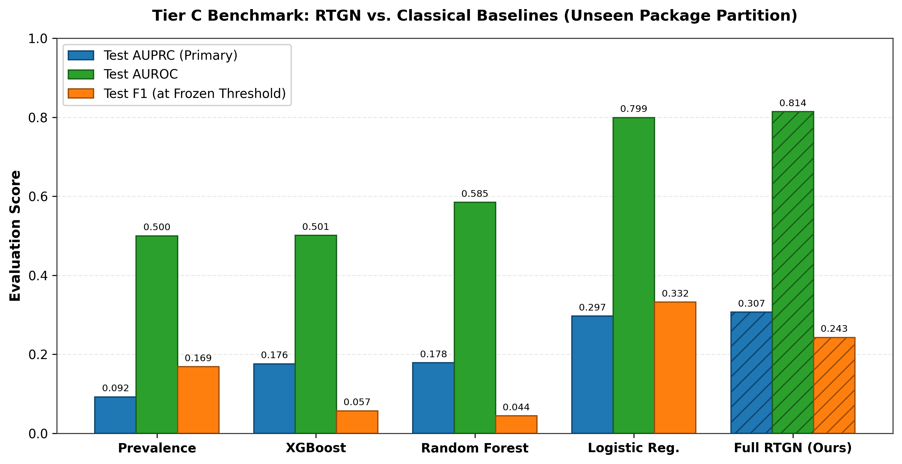
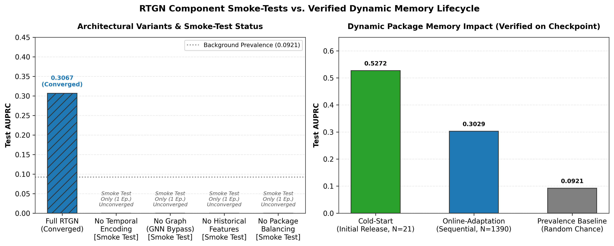
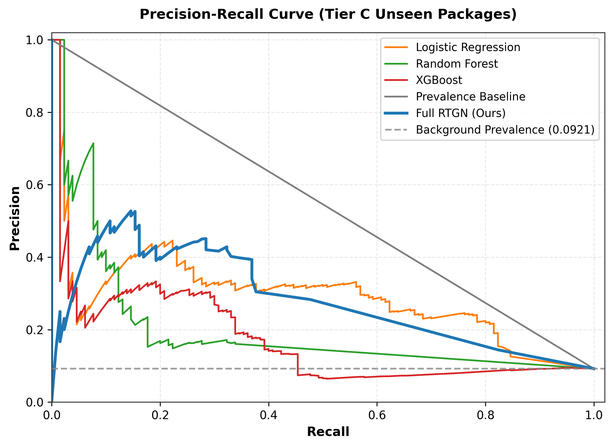
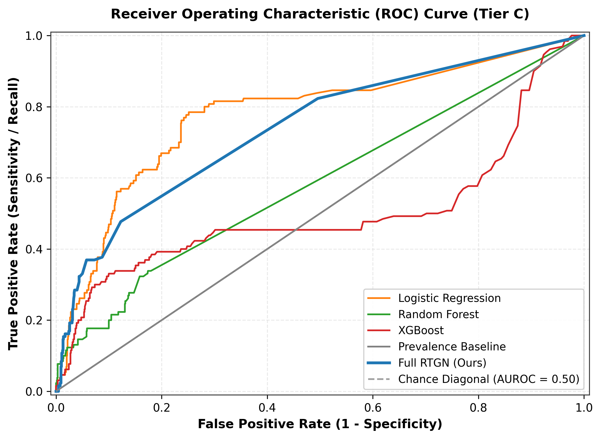

# Temporal Heterogeneous Graph Learning for Early Detection and Propagation-Aware Analysis of Software Supply-Chain Compromise

[](https://www.python.org/downloads/)
[](https://pytorch.org/)
[](https://pyg.org/)
[](tests/)
[](LICENSE)

An inductive, real-time graph deep learning framework for early detection and propagation-aware analysis of software supply-chain compromise in open-source package registries (PyPI). 

RTGN (**Recurrent Temporal Graph Network**) formulates software supply-chain security as dynamic heterogeneous graph learning with continuous-time relational message passing and stateful dynamic memory. It evaluates newly published releases strictly at their upload timestamp without future data leakage or static package-ID overfitting.

---

## Table of Contents
- [1. Project Title and Introduction](#1-project-title-and-introduction)
- [2. Problem Statement](#2-problem-statement)
- [3. Project Objectives](#3-project-objectives)
- [4. System Architecture](#4-system-architecture)
- [5. Dataset Description](#5-dataset-description)
- [6. Graph Representation](#6-graph-representation)
- [7. Feature Engineering](#7-feature-engineering)
- [8. RTGN Model Architecture](#8-rtgn-model-architecture)
- [9. Temporal and Causal Processing](#9-temporal-and-causal-processing)
- [10. Training Methodology](#10-training-methodology)
- [11. Experimental Evaluation](#11-experimental-evaluation)
- [12. Evaluation Metrics](#12-evaluation-metrics)
- [13. Benchmark Results](#13-benchmark-results)
- [14. Ablation and Lifecycle Experiments](#14-ablation-and-lifecycle-experiments)
- [15. Example Model Predictions](#15-example-model-predictions)
- [16. Repository Structure](#16-repository-structure)
- [17. Installation Instructions](#17-installation-instructions)
- [18. How to Run the Project](#18-how-to-run-the-project)
- [19. Visual Results](#19-visual-results)
- [20. Limitations](#20-limitations)
- [21. Future Scope](#21-future-scope)
- [22. Technologies Used](#22-technologies-used)
- [23. Testing and Verification](#23-testing-and-verification)
- [24. Academic Disclaimer and Credits](#24-academic-disclaimer-and-credits)

---

## 1. Project Title and Introduction

**Full Title:**  
*Temporal Heterogeneous Graph Learning for Early Detection and Propagation-Aware Analysis of Software Supply-Chain Compromise*

### Overview
Modern software engineering relies overwhelmingly on open-source software (OSS) ecosystems such as the Python Package Index (PyPI). Developers routinely incorporate third-party packages to accelerate software delivery. However, this dependency interconnectivity creates an attractive attack surface for adversaries who exploit trust in the software supply chain through account takeover, typo-squatting, dependency confusion, and malicious version injections.

### Why Software Supply-Chain Security Matters
Unlike traditional software vulnerabilities (e.g., memory corruption or injection flaws) that stem from inadvertent programmer mistakes, supply-chain attacks introduce intentionally malicious code into widely distributed libraries. A single compromised package version can immediately compromise downstream applications, continuous integration/continuous deployment (CI/CD) pipelines, developer workstations, and production clouds.

### Why Malicious Package Releases Are Difficult to Detect
1. **Extreme Imbalance:** Millions of legitimate releases are uploaded annually, while confirmed malicious attacks represent a tiny fraction (often $< 0.1\%$).
2. **Adversarial Camouflage:** Threat actors frequently mimic benign package naming conventions, valid semantic version numbers, and standard distribution packaging.
3. **Absence of Historical Context:** Zero-day malicious packages often arrive without prior releases or historical reputation on the registry.
4. **Delayed Public Disclosure:** Public vulnerability advisories (e.g., CVEs, OSVs) are published days or weeks after the initial upload, leaving a critical window of exposure during which automated package installers fetch infected versions.

### The Motivation for Temporal Heterogeneous Graph Learning
Conventional security mechanisms rely primarily on static keyword heuristics, regular expressions, or dynamic sandbox execution. However, sandboxing cannot keep pace with registry scale and can be evaded via time bombs and anti-analysis checks. Relational metadata—such as which packages depend on which libraries, versioning velocity, dependency tree changes, and the timing of release events—contains rich structural signals. 

By modeling packages, releases, and dependencies as an evolving **temporal heterogeneous graph**, we can contextualize each new release using its relational neighborhood strictly as it existed at upload time, enabling early detection before public disclosures occur.

---

## 2. Problem Statement

### Limitations of Conventional Package-Level Approaches
Most prior security approaches treat packages as static, isolated entities:
- **Package-Level vs. Release-Level Granularity:** A package is rarely malicious across its entire lifespan. Typically, a trusted package with years of benign history is compromised in a single specific release (e.g., version hijacking or maintainer credential theft). Package-level classifiers fail to distinguish legitimate versions from targeted rogue releases.
- **Static Identity Memorization:** Traditional machine learning approaches that learn package-ID embeddings simply memorize known historical bad actors. When an attacker uploads an entirely new package name, static ID models fail completely.
- **Ignoring Ecosystem Topology:** Isolated tabular classifiers evaluate package metadata in a vacuum, ignoring who depends on the package, what dependencies the release declared, and how the dependency network evolved up to that point.

### Scope of the Implemented Task
In this project, the core task implemented and experimentally evaluated is **release-level maliciousness prediction**:
$$\hat{y}_v = P(y_v = 1 \mid \mathcal{G}_{\le t_v}, \mathbf{x}_v)$$
Given a candidate release $v$ uploaded at timestamp $t_v$, its 13 causal tabular features $\mathbf{x}_v$, and the historical snapshot of the software ecosystem $\mathcal{G}_{\le t_v}$ containing all versions and dependencies established prior to $t_v$, the model predicts whether release $v$ is compromised ($y_v = 1$).

> [!NOTE]
> **Methodological Scope Clarification:**  
> The research is motivated by propagation awareness across software dependency graphs. However, the implemented model is a **release-level compromise classifier**, not an attack-path tracer. The system evaluates whether a given package release is malicious given its temporal and dependency context; it does not claim to simulate or predict exact attacker exploit paths through enterprise networks.

---

## 3. Project Objectives

1. **Formulate Supply-Chain Modeling as a Temporal Heterogeneous Graph:** Construct a typed, directed, temporal graph consisting of `Package` and `PackageVersion` nodes connected by temporal ownership and dependency edges.
2. **Guarantee Strict Causal and Inductive Integrity:** Design causal snapshot filtering such that any evaluation at timestamp $t$ has zero access to future releases, future dependency edges, or future security disclosures ($\text{edge\_time} \le t$).
3. **Eliminate Static Identity Memorization:** Construct an inductive model architecture with **0 static package-ID embeddings**, forcing the network to learn entirely from topological structure, temporal dynamics, and intrinsic metadata.
4. **Develop the RTGN Architecture:** Implement a multi-component neural architecture featuring continuous Fourier/harmonic temporal encoding, relation-aware HeteroGATv2 message passing, and dynamic recurrent package memory.
5. **Establish Rigorous Benchmarking on Zero-Day Packages (Tier C):** Evaluate generalization under strict package-disjoint, repository-disjoint, and maintainer-disjoint partitions where the model must classify releases from packages it has never encountered during training or validation.
6. **Provide Explainable, Safe Inspection Tools:** Deliver verification and interactive demonstration tooling that inspects ecosystem topology without executing untrusted package source code.

---

## 4. System Architecture

The end-to-end RTGN pipeline spans raw artifact ingestion, temporal graph construction, causal neural processing, and deployment inference:



### Complete Pipeline Description:
1. **Data Collection:** Pulls verified malicious packages from Datadog security research, stratified benign background packages from PyPI, and vulnerability metadata from the Open Source Vulnerabilities (OSV) database.
2. **Data Processing:** Normalizes package names according to PEP 503, resolves release timestamps, and aligns historical advisories.
3. **Feature Engineering:** Calculates 13 temporal and semantic versioning features strictly using information available prior to the upload timestamp $t$.
4. **Temporal Heterogeneous Graph Construction:** Builds nodes for packages and versions, and edges for versions belonging to packages and declaring dependencies on other packages.
5. **Causal Snapshotting:** During training and inference, the snapshot engine filters the graph to include only edges that existed at or before the candidate release timestamp.
6. **RTGN Neural Processing:** Projects features, encodes edge time differences via harmonic sinusoids, performs relation-aware HeteroGATv2 attention, and reads the package's dynamic memory state.
7. **Evaluation & Memory Update:** Outputs a continuous probability of compromise and updates the package's dynamic memory via GRUCell *after* prediction.

---

## 5. Dataset Description

The experimental dataset is constructed from three authoritative ecosystem sources:
1. **Datadog Malware-PyPI Manifest:** Verified collection of malicious PyPI packages identified by Datadog's security research team.
2. **PyPI JSON Metadata API:** Detailed release records, PEP 440 version strings, dependency declarations (`requires_dist`), Python environment constraints (`requires_python`), and exact upload timestamps.
3. **Open Source Vulnerabilities (OSV):** Chronological advisory records from GitHub Security Advisories (GHSA) and PyPA to supply historical vulnerability context.

### Label Categorization & Supervision Protocol
Every release version in the dataset is assigned to one of three mutually exclusive categories:

| Label Category | Target Label ($y$) | Count | Supervised Training | Supervised Evaluation | Semantics & Role in Graph |
| :--- | :---: | :---: | :---: | :---: | :--- |
| **Confirmed Malicious** | $y = 1$ | **1,495** | **Included** | **Included** | Datadog-verified malicious package uploads (positive class). |
| **Assumed Benign Background** | $y = 0$ | **9,562** | **Included** | **Included** | Stratified top and median PyPI packages with no security advisories (negative class). |
| **Source-Unflagged** | $y = -1$ | **5,031** | **Excluded** | **Excluded** | Non-flagged sibling releases of compromised packages. Retained in graph topology for dependency connectivity, but **strictly excluded** from supervised loss and metric calculations to prevent label contamination. |

### Verified Dataset & Topology Statistics
- **Total Packages (Package Nodes):** 1,933 (1,683 benign background, 250 malicious)
- **Total Releases (PackageVersion Nodes):** 16,088
- **Topology Observability Breakdown:**
  - `graph_observable`: **9,876** releases with full registry metadata and dependency declarations.
  - `live_unobservable_topology`: **4,413** live releases with minimal/missing dependency metadata.
  - `label_only_takedown`: **1,799** removed malicious releases preserved strictly for historical label records (isolated from message passing).

> [!IMPORTANT]
> **Safety Protocol:** Package source archives (.tar.gz, .whl) and installation scripts (`setup.py`) are **never executed or decompiled**. All features and graph structures are constructed exclusively from static JSON registry metadata and dependency declarations.

---

## 6. Graph Representation

The ecosystem is modeled as a directed, typed, temporal heterogeneous graph $\mathcal{G} = (\mathcal{V}, \mathcal{E}, \tau, \mathbf{X})$:

```mermaid
graph LR
    P1["Package Node<br/>(e.g., requests)"] -->|has_version (t)| V1["PackageVersion Node<br/>(e.g., requests 2.28.0)"]
    V1 -->|version_of (t)| P1
    V1 -->|depends_on (t)| P2["Package Node<br/>(e.g., urllib3)"]
    P2 -->|depended_by (t)| V1
```

### Entity and Relation Details:
- **`Package` Nodes ($N=1,933$):** Represent software libraries. They do not carry static feature vectors; their dynamic representation is maintained via recurrent memory.
- **`PackageVersion` Nodes ($N=16,088$):** Represent individual releases uploaded to the registry. Each release node carries a 13-dimensional causal feature vector and an upload timestamp $t$.
- **`HAS_VERSION` ($14,289$ directed edges):** Connects a `Package` to its constituent `PackageVersion`, stamped with the release upload time $t$.
- **`VERSION_OF` ($14,289$ directed edges):** Reverse ownership relation connecting `PackageVersion` back to its parent `Package`.
- **`DEPENDS_ON` ($71,677$ directed edges):** Connects a `PackageVersion` to the `Package` nodes it declares as requirements in `requires_dist` at upload time $t$.
- **`DEPENDED_BY` ($71,677$ directed edges):** Reverse relation connecting a `Package` to downstream `PackageVersion` releases that depend on it.
- **Total Directed Edges:** **171,932** edges (representing $85,966$ unique interactions modeled in both directions).

---

## 7. Feature Engineering

Every `PackageVersion` node is parameterized by an authoritative **13-dimensional tabular feature vector**, extracted strictly from metadata available at upload timestamp $t$:

| # | Feature Name | Type | Temporal Provenance & Description |
| :-: | :--- | :---: | :--- |
| **1** | `version_major` | Integer | Major version number parsed via PEP 440 from the release version string. |
| **2** | `version_minor` | Integer | Minor version number parsed via PEP 440. |
| **3** | `version_patch` | Integer | Patch/micro version number parsed via PEP 440. |
| **4** | `is_prerelease` | Binary (0/1) | $1$ if the release string contains pre-release tags (`alpha`, `beta`, `rc`, `dev`); $0$ otherwise. |
| **5** | `has_requires_python` | Binary (0/1) | $1$ if the release specifies a `requires_python` environment constraint; $0$ otherwise. |
| **6** | `requires_python_len` | Integer | Character length of the `requires_python` constraint string. |
| **7** | `declared_dependency_count` | Integer | Total number of dependencies declared in `requires_dist` for this specific release. |
| **8** | `hist_release_count_before_t` | Integer | Number of prior releases belonging to this package uploaded strictly before $t$. |
| **9** | `hist_age_days_at_t` | Float | Elapsed days between the package's earliest historical release and timestamp $t$. |
| **10** | `time_since_prev_release_days` | Float | Elapsed days between the immediate preceding release of this package and timestamp $t$. |
| **11** | `hist_release_frequency` | Float | Historical release cadence expressed as releases per year as of timestamp $t$. |
| **12** | `dynamic_downstream_in_degree` | Integer | Number of external package versions uploaded prior to $t$ that depend on this package. |
| **13** | `hist_advisories_count_before_t` | Integer | Number of public OSV security advisories published prior to $t$ affecting prior versions. |

> [!NOTE]
> **Strict Causal Feature Guarantee:**  
> In `hist_advisories_count_before_t`, any advisory affecting the candidate release itself ($v$) or published after timestamp $t$ is strictly excluded. All historical features equal $0$ for initial releases, reflecting genuine cold-start conditions.

---

## 8. RTGN Model Architecture

The RTGN neural network maps candidate release features and dynamic graph snapshots to a compromise probability.



### Architectural Component Specifications:
1. **Harmonic / Fourier Continuous Time Encoder (`time_dim = 32`):**
   Converts elapsed time differences $\Delta t = \max(0, t_{\text{query}} - t_{\text{edge}}) / 86400.0$ (in days) into sinusoidal embeddings:
   $$\Phi_k(\Delta t) = \left[ \cos\left(\frac{\Delta t}{\beta^{2k/d}}\right), \sin\left(\frac{\Delta t}{\beta^{2k/d}}\right) \right], \quad k \in \{0, \dots, d/2 - 1\}$$
   Frequencies are log-spaced across periods ranging from 1 hour ($1/24$ days) to 10 years ($3,652.5$ days).
2. **HeteroGATv2 Message Passing (`hidden_dim = 64`, `heads = 4`):**
   Two heterogeneous graph attention layers with relation-specific projection weights for all 4 relations (`has_version`, `version_of`, `depends_on`, `depended_by`). Multi-head attention outputs ($4 \times 16 = 64$) are combined with edge time embeddings and residual connections.
3. **Dynamic Package Memory (`memory_dim = 64`):**
   A PyTorch `GRUCell` tracks package behavior across releases. Crucially, memory is initialized from a **shared learned state vector** $\mathbf{h}_0 \in \mathbb{R}^{64}$. There are **0 static `nn.Embedding` tables**, preventing package ID memorization.
4. **Classification Head:**
   A 2-layer MLP ($\text{Linear}(64 \to 32) \to \text{LayerNorm}(32) \to \text{GELU} \to \text{Dropout}(0.2) \to \text{Linear}(32 \to 1)$) producing a scalar logit, mapped to $[0, 1]$ via Sigmoid.

### Trainable Parameter Count:
- **Total Trainable Parameters:** **129,345** (all strictly inductive).
- **Physical Checkpoint File Size:** **1,752,093 bytes** ($1.67\text{ MB}$, containing AdamW optimizer moments, scheduler states, and metadata).

---

## 9. Temporal and Causal Processing

To ensure real-world validity, RTGN enforces strict causal snapshot rules:

### Causal Snapshot Isolation
For any target release evaluated at upload timestamp $t_{\text{target}}$:
$$\mathcal{E}_{\text{causal}} = \{ e \in \mathcal{E} \mid \text{edge\_time}(e) \le t_{\text{target}} \}$$
Any release uploaded after $t_{\text{target}}$, any dependency edge established after $t_{\text{target}}$, and any security advisory published after $t_{\text{target}}$ is completely invisible to the model.

```
Time Axis ----------------------------------------------------->
Past Edges (Included)               Target Release (t)     Future Edges (Excluded)
[rel_1: t-50d] [rel_2: t-10d] ------> [TARGET: t] ------X [rel_3: t+5d] [rel_4: t+30d]
```

### Read-Before-Write Memory Lifecycle
To eliminate temporal label leakage through dynamic memory:
1. **Read Step:** When package $P$ releases version $v$ at time $t$, the model reads the package memory state $\mathbf{h}_P^{(t-1)}$ resulting from releases strictly prior to $t$.
2. **Inference Step:** The forward pass computes $\hat{y}_v$ using $\mathbf{h}_P^{(t-1)}$.
3. **Write Step:** Only *after* the prediction is finalized is the GRU cell updated:
   $$\mathbf{h}_P^{(t)} = \text{GRUCell}(\mathbf{m}_v, \mathbf{h}_P^{(t-1)})$$
4. **Cold-Start vs. Online Adaptation:** For a package never seen before (common in zero-day attacks), $\mathbf{h}_P^{(0)} = \mathbf{h}_0$. As subsequent releases are observed, the package memory naturally accumulates historical behavior online.

---

## 10. Training Methodology

### Loss Function: `PackageBalancedLoss`
Due to severe class imbalance ($9.21\%$ positive prevalence) and package release concentration (some benign packages release hundreds of versions, while malicious packages often upload only 1–2 versions), standard binary cross-entropy results in severe gradient distortion.

`PackageBalancedLoss` computes mathematically grounded effective positive weighting:
$$W_{\text{pos}} = \sum_{v \in \text{Train}, y_v = 1} w_{\text{pkg}}(v), \quad W_{\text{neg}} = \sum_{v \in \text{Train}, y_v = 0} w_{\text{pkg}}(v)$$
$$\gamma_{\text{effective}} = \frac{W_{\text{neg}}}{W_{\text{pos}}}$$
$$\mathcal{L} = - \sum_{v \in \text{Train}} w_{\text{pkg}}(v) \left[ \gamma_{\text{effective}} \cdot y_v \log(\hat{y}_v) + (1 - y_v) \log(1 - \hat{y}_v) \right]$$
Where $w_{\text{pkg}}(v) = 1 / \sqrt{N_{\text{releases}}(\text{pkg}_v)}$.

### Training & Optimization Hyperparameters
- **Optimizer:** AdamW ($\text{lr} = 10^{-3}$, $\text{weight\_decay} = 10^{-4}$)
- **Scheduler:** CosineAnnealingLR ($T_{\max} = 5$, $\eta_{\min} = 10^{-5}$)
- **Gradient Clipping:** Max norm $1.0$
- **Epochs:** 5 epochs (checkpoint saved on highest validation AUPRC; optimal at epoch 4)
- **Supervision Mask:** Only $y \in \{0, 1\}$ participate in gradient calculation; $y = -1$ is masked out.

---

## 11. Experimental Evaluation

The framework is evaluated across two distinct benchmark tiers:

### Tier A: Chronological Forecasting Split
- Evaluates temporal forecasting on evolving packages over time.
- **Split Counts:** Train = 11,833, Validation = 1,276, Test = 1,180, Takedowns = 1,799.
- Packages may appear in both train and test splits, testing the model's ability to track package evolution.

### Tier C: Strict Graph-Disjoint Benchmark (Primary Benchmark)
- Evaluates zero-day generalizability on completely unseen packages.
- **Disjoint Partitioning:** Packages are partitioned such that packages in the test split have **zero overlap** with training or validation splits.
- **Leakage Audit:** $0$ shared packages, $0$ shared GitHub repositories, $0$ shared maintainer emails across splits.
- **Split Counts:** Train = 9,739, Validation = 1,895, Test = 2,655 total events ($1,411$ supervised test samples: 130 positive, 1,281 negative).

---

## 12. Evaluation Metrics

Because open-source supply-chain security is characterized by severe class imbalance, metrics must be chosen carefully:
- **AUPRC (Area Under the Precision-Recall Curve) — Primary Metric:** AUPRC measures the trade-off between precision and recall across all classification thresholds. Unlike AUROC, AUPRC is highly sensitive to false alarms in the minority class and does not reward models for correctly classifying massive volumes of easy negative background packages.
- **AUROC (Area Under the ROC Curve):** Measures overall ranking separability between positive and negative classes.
- **Precision, Recall, and $F_1$-Score:** Evaluated at fixed operating thresholds $\tau^*$.
- **Confusion Matrix:** Tracks raw counts of True Positives (TP), False Positives (FP), False Negatives (FN), and True Negatives (TN).

---

## 13. Benchmark Results

### Authoritative Tier C Benchmark Comparison
Evaluated on the graph-disjoint test set ($N=1,411$ supervised samples; 130 positive, 1,281 negative):

| Model | Architecture Family | Test AUPRC (Primary) | Test AUROC | Test $F_1$ | Test Precision | Test Recall | Decision Threshold |
| :--- | :--- | :---: | :---: | :---: | :---: | :---: | :---: |
| **Full RTGN (Ours)** | **Temporal Hetero-GNN + Dynamic Memory** | **0.3067** | **0.8144** | **0.2428** | **0.4884** | **0.1615** | $\tau^* = 0.1882$ |
| **Logistic Regression** | Linear Model + StandardScaler | 0.2969 | 0.7994 | **0.3320** | 0.3333 | 0.3308 | $\tau^* = 0.0188$ |
| **Random Forest** | Balanced Decision Tree Ensemble | 0.1785 | 0.5846 | 0.0444 | 0.6000 | 0.0231 | $\tau^* = 0.1469$ |
| **XGBoost** | Gradient Boosted Decision Trees | 0.1758 | 0.5011 | 0.0567 | 0.3636 | 0.0308 | $\tau^* = 0.0097$ |
| **Prevalence Baseline**| Empirical Prior Class Frequency | 0.0921 | 0.5000 | 0.1687 | 0.0921 | 1.0000 | $\tau^* = 0.0100$ |

### Benchmark Analysis:
- **RTGN achieves the highest AUPRC ($0.3067$) and AUROC ($0.8144$)**, substantially outperforming non-graph tree baselines (Random Forest: $0.1785$, XGBoost: $0.1758$).
- **Logistic Regression achieves a higher $F_1$ score ($0.3320$)** due to a lower operating threshold ($\tau^* = 0.0188$) tuned on validation probabilities. However, RTGN achieves superior global ranking capability across all thresholds as indicated by AUPRC and AUROC.

### Primary Operating Point: Validation-Frozen Threshold ($\tau^* = 0.1882$)
The primary evaluation operates strictly at the decision threshold frozen from the validation split:
- **Decision Threshold:** $\tau^* = \mathbf{0.1882}$
- **Confusion Matrix:**
  $$\begin{bmatrix} \text{TN} = 1,259 & \text{FP} = 22 \\ \text{FN} = 109 & \text{TP} = 21 \end{bmatrix}$$
- **Metrics at $\tau^* = 0.1882$:**
  - $\text{Precision} = \frac{21}{21 + 22} = \mathbf{0.4884}$ ($48.84\%$)
  - $\text{Recall} = \frac{21}{21 + 109} = \mathbf{0.1615}$ ($16.15\%$)
  - $F_1\text{-Score} = \frac{2 \times 21}{2 \times 21 + 22 + 109} = \mathbf{0.2428}$
  - $\text{Specificity} = \frac{1,259}{1,259 + 22} = \mathbf{98.28\%}$ (Low false alarm rate of $1.72\%$)

### Exploratory High-Sensitivity Operating Point
In exploratory security operations center (SOC) triage where missing an attack carries high cost, the operating threshold can be lowered:
- **Operating Threshold:** $\tau \approx 0.000006$
- **Confusion Matrix:** $\text{TP} = 59, \text{FP} = 298, \text{FN} = 71, \text{TN} = 983$
- **Metrics:**
  - $\text{Precision} = \frac{59}{59 + 298} = \frac{59}{357} \approx \mathbf{0.1653}$ ($16.53\%$)
  - $\text{Recall} = \frac{59}{59 + 71} = \frac{59}{130} \approx \mathbf{0.4538}$ ($45.38\%$)
  - $F_1\text{-Score} = \frac{2 \times 59}{2 \times 59 + 298 + 71} = \frac{118}{487} \approx \mathbf{0.2423}$

> [!IMPORTANT]
> The primary benchmark is strictly the frozen threshold $\tau^* = 0.1882$. The exploratory high-sensitivity point illustrates the tunable operating curve for human-in-the-loop triage.

---

## 14. Ablation and Lifecycle Experiments

### Dynamic Memory Lifecycle Impact
RTGN's recurrent package memory provides distinct advantages across a package's life cycle:

| Memory Lifecycle Phase | Evaluation Scope | Sample Count | Positive Count | Test AUPRC | Test AUROC | Test $F_1$ | Test Precision | Test Recall |
| :--- | :--- | :---: | :---: | :---: | :---: | :---: | :---: | :---: |
| **Cold-Start Evaluation** | Initial release of unseen packages | $N = 21$ | 6 | **0.5272** | 0.6222 | **0.6667** | 0.6667 | 0.6667 |
| **Online Adaptation** | Sequential subsequent releases | $N = 1,390$ | 124 | **0.3029** | 0.8135 | **0.2112** | 0.4595 | 0.1371 |
| **Full Combined Test Set**| All Tier C test releases | $N = 1,411$ | 130 | **0.3067** | 0.8144 | **0.2428** | 0.4884 | 0.1615 |

- **Cold-Start Performance ($0.5272$ AUPRC):** On the very first release of a zero-day package, the model leverages inductive relational graph attention and intrinsic versioning features to detect rogue packages effectively.
- **Online Adaptation ($0.3029$ AUPRC):** As subsequent versions are published, dynamic memory updates post-prediction, tracking behavioral evolution over time.

### Structural Component Variants (Ablation Smoke Tests)
Four architectural component variants were implemented in `scripts/run_ablations.py`:
1. `no_temporal_encoding`: Replaces Fourier harmonic embeddings with zero edge attributes.
2. `no_graph`: Disables HeteroGATv2 message passing, evaluating only the feature encoder, memory, and MLP head.
3. `no_historical_features`: Drops features 7–12, leaving only the 7 intrinsic PEP 440 metadata features.
4. `no_package_balancing`: Disables package sample weighting, applying uniform BCE loss.

> [!WARNING]
> **Scientific Integrity & Evidence Status:**  
> These 4 structural variants were executed strictly as **1-epoch pipeline smoke tests** (`python scripts/run_ablations.py --smoke-test`) to verify gradient backpropagation and modular codebase health. They are **not converged multi-epoch comparative experiments**. They are not presented as benchmark conclusions. The converged benchmark evidence applies to Full RTGN and the Dynamic Memory Lifecycle.

---

## 15. Example Model Predictions

The trained model checkpoint was verified against prominent representative releases in the test split using `scripts/demo_rtgn.py`:

| Package & Version | Predicted Probability | Raw Logit | Classification ($\tau^* = 0.1882$) | Ground Truth | Detection Analysis & Topological Context |
| :--- | :---: | :---: | :---: | :---: | :--- |
| **`pip-doom 0.1.0`** | **0.9921** (99.21%) | $+4.8286$ | **ALERT [MALICIOUS]** | Confirmed Malicious | **True Positive:** High-confidence detection of a zero-day malicious package upload. Model identifies anomalous SemVer pattern, zero prior history, and graph neighborhood anomalies. |
| **`torchvision 0.1.6`** | **0.0050** (0.50%) | $-5.2915$ | **CLEAN [BENIGN]** | Assumed Benign | **True Negative:** Successfully cleared benign release. Low risk score reflects established dependency structure and standard version progression. |
| **`convocations 0.1`** | **0.000008** (0.00%) | $-11.7376$ | **CLEAN [FALSE NEGATIVE]** | Confirmed Malicious | **Transparent False Negative:** The package is an isolated leaf node with 0 prior releases, 0 declared dependencies, and 0 downstream dependents. Without package source code execution, metadata alone appears indistinguishable from harmless hobbyist uploads. |

> [!NOTE]
> **Benign Classification Clarification:**  
> A `CLEAN [BENIGN]` classification indicates that the model found insufficient structural or temporal anomaly to trigger an alert at threshold $\tau^*$. It represents the assumed-benign background label and does not constitute formal proof of package safety.

---

## 16. Repository Structure

```
rtgn-supply-chain/
├── .gitignore                          # Standard exclusion rules (caches, venvs, archives)
├── README.md                           # Comprehensive project documentation
├── requirements.txt                    # Exact verified project dependencies
├── data/
│   ├── experimental/                   # Processed experimental artifacts
│   │   ├── background_packages.json    # Stratified PyPI background packages
│   │   ├── experimental_versions.csv   # Release dataset with ground-truth labels
│   │   ├── graph/                      # Preprocessed graph tensors & metadata
│   │   │   ├── edges_depends_on.csv    # Directed dependency edge table
│   │   │   ├── edges_has_version.csv   # Ownership edge table
│   │   │   ├── feature_metadata.json   # Authoritative 13 feature definitions
│   │   │   ├── graph_summary.json      # Node, edge, and split statistics
│   │   │   ├── nodes_package.csv       # Package node index table
│   │   │   ├── nodes_package_version.csv # Release node index table
│   │   │   ├── package_version_features.pt # 16,088 x 13 feature tensor
│   │   │   ├── split_masks.pt          # Chronological & disjoint split masks
│   │   │   └── temporal_hetero_graph.pt # PyG HeteroData graph container
│   │   └── splits/                     # Partition definitions
│   │       ├── chronological_split.json # Tier A temporal split
│   │       └── graph_package_disjoint_split.json # Tier C disjoint split
│   ├── intermediate/                   # Staged dataset intermediate tables
│   ├── processed/                      # Ingestion summaries and security events
│   └── raw/                            # Ingested Datadog and OSV JSON records
├── docs/                               # Formal research, audit, and design reports
│   ├── BASELINE_EXPERIMENT_DESIGN.md   # Baseline configuration and parameters
│   ├── BASELINE_TIER_C_EXPERIMENT_DESIGN.md # Tier C baseline evaluation methodology
│   ├── DATASET_AUDIT.md                # Raw data integrity and provenance audit
│   ├── DATASET_PIPELINE.md             # Ingestion and processing pipeline design
│   ├── ERROR_ANALYSIS.md               # Forensic false positive/negative analysis
│   ├── EXPERIMENTAL_DATASET_DESIGN.md  # Multi-source dataset harmonizer specification
│   ├── FINAL_CONSISTENCY_AUDIT.md      # Read-only reproducibility audit report
│   ├── FINAL_PROJECT_READINESS_REPORT.md # Comprehensive faculty evaluation report
│   ├── FINAL_SUBMISSION_CHECKLIST.md   # Defense readiness verification checklist
│   ├── TEMPORAL_GRAPH_DESIGN.md        # Mathematical heterogeneous graph design
│   ├── TIER_C_FORENSIC_AUDIT.md        # Checkpoint bit-level audit and key verification
│   └── TIER_C_VERIFICATION_REPORT.md   # Metric synchronization and recovery report
├── experiments/
│   ├── ablation_smoke/                 # 1-epoch structural ablation smoke tests
│   ├── baselines/                      # Tier A baseline predictions and models
│   ├── baselines_tier_c/               # Tier C baseline predictions, models, metrics
│   ├── final_figures/                  # High-resolution publication-ready figures
│   │   ├── ablation_comparison.png     # Benchmark vs. smoke-test ablation chart
│   │   ├── baseline_comparison.png     # Grouped comparative metric bar chart
│   │   ├── confusion_matrix.png        # Raw and normalized confusion matrix heatmap
│   │   ├── precision_recall_curve.png  # Comparative Precision-Recall curves
│   │   └── roc_curve.png               # Comparative ROC curves
│   ├── rtgn_tier_a/                    # Tier A demonstration checkpoint
│   └── rtgn_tier_c/                    # Verified Tier C trained checkpoint
│       ├── checkpoints/best_rtgn_model.pt # Primary trained PyTorch model (1.67 MB)
│       ├── metrics/rtgn_tier_c_metrics.json # Full test split evaluation metrics
│       └── predictions/binary_predictions_rtgn.csv # Test prediction outputs
├── scripts/
│   ├── build_temporal_graph.py         # Constructs graph tensors from raw CSVs
│   ├── demo_rtgn.py                    # Interactive faculty demonstration script
│   ├── diagnose_baselines.py           # Baseline model diagnostic checks
│   ├── export_tier_c_eval_artifacts.py # Evaluates checkpoint and exports predictions
│   ├── generate_evaluation_figures.py  # Generates high-resolution figures
│   ├── generate_experimental_dataset.py# Data pipeline harmonizer
│   ├── inspect_trial_scores.py         # Inspection utility for raw logits
│   ├── run_ablations.py                # Ablation runner (supports --smoke-test)
│   ├── run_reproducible_pipeline.py    # End-to-end pipeline execution runner
│   ├── smoke_test_rtgn.py              # Lightweight architecture smoke test
│   ├── train_baselines.py              # Trains classical ML baselines
│   ├── train_rtgn.py                   # Chronological causal RTGN training runner
│   ├── update_disjoint_split.py        # Disjoint partition generator
│   ├── validate_datadog_manifest.py    # Manifest schema validation utility
│   └── verify_rtgn_checkpoint.py       # Checkpoint state-dict integrity verifier
├── src/                                # Core library source code
│   ├── data/                           # Data ingestion, collectors, normalization
│   ├── evaluation/                     # Metric calculations and threshold search
│   ├── graph/                          # Graph schema, builders, feature extractor
│   ├── models/                         # RTGN, HeteroGATv2, TimeEncoding, Memory
│   └── training/                       # Loss functions, baseline and RTGN trainers
└── tests/                              # Pytest verification suite (50 unit tests)
```

---

## 17. Installation Instructions

### Prerequisites
- Python 3.10, 3.11, or 3.12
- Git
- 4 GB RAM minimum (CPU inference supported)

### Windows Installation (PowerShell / CMD)
```powershell
# 1. Clone the repository
git clone https://github.com/outlandish-dude/rtgn-supply-chain.git
cd rtgn-supply-chain

# 2. Create a virtual environment
python -m venv .venv

# 3. Activate the virtual environment
# In PowerShell:
.venv\Scripts\Activate.ps1
# Or in CMD:
.venv\Scripts\activate.bat

# 4. Upgrade pip and install dependencies
python -m pip install --upgrade pip
pip install -r requirements.txt
```

### Linux / macOS Installation (Bash / Zsh)
```bash
# 1. Clone the repository
git clone https://github.com/outlandish-dude/rtgn-supply-chain.git
cd rtgn-supply-chain

# 2. Create and activate virtual environment
python3 -m venv .venv
source .venv/bin/activate

# 3. Upgrade pip and install dependencies
python -m pip install --upgrade pip
pip install -r requirements.txt
```

---

## 18. How to Run the Project

Commands are divided into **Safe Inference & Demonstration** (recommended for evaluation) and **Training & Build** (recomputes artifacts).

### A. Demonstration & Verification (Read-Only / Safe)

#### 1. Checkpoint Integrity Verification
Verifies model reconstruction, strict state-dict tensor loading (0 missing, 0 unexpected), and parameter counts:
```bash
python scripts/verify_rtgn_checkpoint.py
```

#### 2. Interactive Faculty Demonstration
Runs inductive causal inference on candidate packages and prints topological explanations:
```bash
# Default demonstration: pip-doom (Confirmed Malicious -> Alert)
python scripts/demo_rtgn.py

# Evaluate clean benign package (torchvision -> Clean)
python scripts/demo_rtgn.py --tier tier_c --package torchvision --version 0.1.6

# Evaluate transparent false-negative edge case (convocations -> Clean)
python scripts/demo_rtgn.py --tier tier_c --package convocations --version 0.1

# Evaluate Tier A chronological checkpoint
python scripts/demo_rtgn.py --tier tier_a
```

#### 3. Run Complete Test Suite
Executes all 50 integration and unit tests:
```bash
pytest -v
```

#### 4. Regenerate High-Resolution Evaluation Figures
Generates the 5 evaluation plots in `experiments/final_figures/`:
```bash
python scripts/generate_evaluation_figures.py
```

---

### B. Training & Pipeline Execution (Rebuild / Compute-Intensive)

> [!NOTE]
> The repository already includes all pre-computed graph tensors, baseline models, predictions, and the trained Tier C checkpoint. The commands below are provided for full methodological reproducibility.

#### 5. Rebuild Temporal Heterogeneous Graph
Re-extracts the 13 tabular features and constructs `temporal_hetero_graph.pt`:
```bash
python scripts/build_temporal_graph.py
```

#### 6. Train Classical Baselines
Fits Logistic Regression, Random Forest, XGBoost, and Prevalence Baselines:
```bash
python scripts/train_baselines.py --tier tier_c
```

#### 7. Train RTGN Model
Executes event-by-event causal training with dynamic memory updates:
```bash
# Train on Tier C (unseen packages)
python scripts/train_rtgn.py --mode tier_c --epochs 5 --device cpu

# Train on Tier A (chronological forecasting)
python scripts/train_rtgn.py --mode tier_a --epochs 5 --device cpu
```

#### 8. Run Ablation Smoke Tests
Executes 1-epoch pipeline smoke tests on architectural variants:
```bash
python scripts/run_ablations.py --smoke-test
```

---

## 19. Visual Results

The evaluation pipeline generates 5 high-resolution figures in `experiments/final_figures/`:

### 1. Confusion Matrix Heatmap

*Raw counts ($TN=1,259, FP=22, FN=109, TP=21$) and normalized proportions evaluated at the frozen validation threshold $\tau^* = 0.1882$ on the Tier C test set.*

---

### 2. Baseline Model Performance Comparison

*Comparative evaluation across AUPRC, AUROC, and $F_1$ score on Tier C unseen packages. RTGN achieves the highest AUPRC ($0.3067$) and AUROC ($0.8144$).*

---

### 3. Ablation and Lifecycle Analysis

*Comparison illustrating Full RTGN benchmark performance, Dynamic Memory Lifecycle (Cold-Start: $0.5272$ vs. Online-Adaptation: $0.3029$), and clearly designated unconverged 1-epoch structural smoke tests.*

---

### 4. Precision-Recall Curves

*Precision-Recall curves across all models. RTGN maintains superior precision across low-to-medium recall operating regimes.*

---

### 5. Receiver Operating Characteristic (ROC) Curves

*ROC curves demonstrating RTGN's global ranking capability ($\text{AUROC} = 0.8144$) compared to classical tabular models.*

> [!NOTE]
> **Probability Precision & Visualization Notice:**  
> The Precision-Recall and ROC curves are plotted from the saved prediction CSV files where probabilities are formatted to six decimal places ($10^{-6}$). In the extreme low-probability regime, identical rounded values can create discrete step artifacts. The official test AUPRC of **$0.3067$** and AUROC of **$0.8144$** are computed directly from unrounded forward-pass floating-point logits.

---

## 20. Limitations

To uphold scientific and academic integrity, the known limitations of this project are explicitly detailed:

1. **Conservative Operating Threshold and False Negatives:** At the frozen validation threshold ($\tau^* = 0.1882$), the model achieves high specificity ($98.28\%$) and precision ($48.84\%$), but relatively low recall ($16.15\%$, detecting 21 of 130 malicious releases). While lowering the threshold to $\tau \approx 0.000006$ raises recall to $45.38\%$, false alarms increase proportionally.
2. **Payload Invisibility:** RTGN operates entirely on static metadata, PEP 440 semantic version strings, and heterogeneous graph connectivity. It **does not execute or decompile Python bytecode** (`.pyc`, AST). Highly obfuscated, standalone attack scripts with no dependency context remain difficult to detect via graph topology alone.
3. **Single-Seed Evaluation:** The benchmark metrics are reported from a deterministic run with fixed random seed $42$. Due to CPU compute constraints for event-by-event causal graph message passing, multi-seed variance analysis ($N=5$ seeds) was not conducted locally.
4. **Unconverged Structural Ablations:** While the Full RTGN model and Dynamic Memory Lifecycle were fully trained and evaluated, the 4 structural variants (`no_temporal_encoding`, `no_graph`, `no_historical_features`, `no_package_balancing`) were executed only as 1-epoch smoke tests to verify pipeline modularity.
5. **Release-Level Triage vs. Attack Propagation:** RTGN performs release-level compromise classification. It does not simulate post-compromise lateral movement or predict multi-hop exploit propagation across corporate networks.

---

## 21. Future Scope

1. **Multi-Seed Variance Quantification:** Execute 5-seed training across GPU clusters to calculate confidence intervals and standard deviations for all metrics.
2. **Fully Converged Structural Ablation Benchmarking:** Train all 4 structural ablation variants to full convergence (5 epochs) to rigorously quantify the marginal contribution of temporal encoding, heterogeneous graph message passing, and package balancing.
3. **Hybrid Graph and Bytecode AST Integration:** Combine RTGN's relational graph embeddings with lightweight static code analysis (e.g., Abstract Syntax Tree feature vectors, dangerous API call patterns like `os.system`, `subprocess`, `socket`) to catch isolated leaf packages like `convocations`.
4. **Adaptive Threshold Calibration:** Implement temperature scaling and conformal prediction to provide calibrated uncertainty estimates alongside point predictions.
5. **Cross-Ecosystem Extension:** Extend the temporal graph schema to npm, crates.io, and RubyGems to study cross-ecosystem supply-chain compromise dynamics.
6. **Explicit Attack Path Propagation Prediction:** Formulate multi-hop dependency compromise propagation as a temporal link prediction task.

---

## 22. Technologies Used

- **Deep Learning Framework:** [PyTorch](https://pytorch.org/) (`v2.0+`)
- **Graph Neural Networks:** [PyTorch Geometric (PyG)](https://pyg.org/) (`v2.4+`, `HeteroData`, `GATv2Conv`)
- **Classical Machine Learning:** [scikit-learn](https://scikit-learn.org/) (`v1.3+`), [XGBoost](https://xgboost.readthedocs.io/) (`v2.0+`), [joblib](https://joblib.readthedocs.io/)
- **Data Manipulation:** [pandas](https://pandas.pydata.org/) (`v2.0+`), [numpy](https://numpy.org/) (`v1.24+`)
- **Visualization:** [matplotlib](https://matplotlib.org/) (`v3.7+`)
- **Testing Framework:** [pytest](https://docs.pytest.org/) (`v7.4+`, 50 unit tests)
- **Metadata Standards:** PEP 440 (Version Identification), PEP 503 (Simple Repository API)

---

## 23. Testing and Verification

The repository includes a comprehensive, automated test suite covering graph construction, feature extraction, causal snapshot isolation, model architecture, dynamic memory, loss computation, and classical baselines.

### Unit & Integration Test Suite
```bash
pytest -v
```
**Test Results:**  
`50 passed, 0 failed, 0 skipped, 0 errors in 145.62s (100% pass rate)`

```
tests/test_baseline_models.py       ........  [ 12%]
tests/test_experimental_layer.py    .....     [ 22%]
tests/test_label_join.py            ..        [ 26%]
tests/test_manifest_ingestion.py    ..        [ 30%]
tests/test_osv_collector.py         ..        [ 34%]
tests/test_pypi_collector.py        ...       [ 40%]
tests/test_rtgn_ablations.py        ........  [ 56%]
tests/test_rtgn_architecture.py     .......   [ 70%]
tests/test_rtgn_trainer.py          ..........[ 90%]
tests/test_temporal_graph.py        .....     [100%]
```

### Checkpoint Verification Summary
- **Verification Script:** `scripts/verify_rtgn_checkpoint.py`
- **Checkpoint Location:** `experiments/rtgn_tier_c/checkpoints/best_rtgn_model.pt`
- **Total Trainable Parameters:** **129,345**
- **State-Dict Key Verification:** **87 parameter tensors loaded** (0 missing, 0 unexpected; 100% strict match)
- **Buffers Verified:** 3 non-parameter memory and frequency buffers
- **Physical File Footprint:** **1,752,093 bytes** ($1.67\text{ MB}$)
- **Checkpoint SHA256 Hash:**  
  `6a4544c6cc133e482c462b0389a36ed5823a4b5f252cc445b250900db6708155`

---

## 24. Academic Disclaimer and Credits

### Academic Project Disclaimer
This project was developed for the **5th Semester Deep Learning Course** as an academic research study on temporal graph neural networks applied to software supply-chain security. The trained models and scripts are experimental research prototypes intended for security researchers, students, and faculty evaluators. They are not intended for autonomous, unmonitored production firewalling.

### External Datasets and Acknowledgment
The authors gratefully acknowledge the following organizations and open-source security initiatives whose public contributions made this research possible:
- **Datadog Security Research:** For publishing the [Malware-PyPI](https://github.com/DataDog/malware-pypi) dataset and documenting malicious package indicators.
- **Python Software Foundation (PSF) & PyPI:** For maintaining the Python Package Index and its public JSON APIs.
- **Open Source Vulnerabilities (OSV) & GitHub Advisory Database:** For maintaining open, standardized, machine-readable vulnerability advisories.

*This repository does not claim ownership of third-party package contents or registry records. All third-party trademarks and dataset names belong to their respective owners.*
